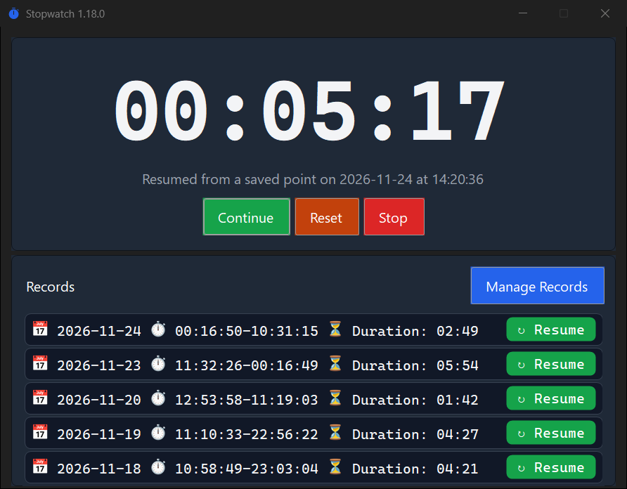

# Stopwatch



Tiny stopwatch built with C#, .NET 10 and WinForms with record keeping and session resume.

## Features

- Start, pause, lap, stop, and reset
- Tray icon with live elapsed time (click to show/hide)
- Session history with laps (local SQLite)
- Resume a mistakenly stopped session
- Auto-pause on lock, screen saver, or display off
- Crash/close recovery (autosave, reopens paused)
- Stop and reset confirmation
- Keyboard shortcuts (`Space`, `Shift+Space`, `Enter`)
- Light/dark theme and per-monitor DPI
- Single instance, fully offline

## Technical specifications

- **Language / runtime:** C# 13 on **.NET 10** (`net10.0-windows`).
- **OS:** **Windows 11** only (framework-dependent — the target machine needs the .NET 10 Desktop
  Runtime installed).
- **Architecture:** x64 only.
- **UI framework:** Windows Forms (WinForms), with `Application.SetColorMode` for live theme
  switching and `PerMonitorV2` high-DPI awareness.
- **Storage:** a single local SQLite file at `%LOCALAPPDATA%\StopwatchApp\stopwatch.db`, created on
  first run.
- **Testing:** xUnit, 285 tests covering timer state transitions, formatting, layout helpers, and
  SQLite persistence.

## Building

Requires the [.NET 10 SDK](https://dotnet.microsoft.com/download) on Windows 11.

```powershell
dotnet build -c Release
```

## Running

```powershell
dotnet run --project StopwatchApp -c Release
```

Or run the built executable directly:

```powershell
StopwatchApp\bin\x64\Release\net10.0-windows\win-x64\StopwatchApp.exe
```

## Testing

```powershell
dotnet test
```

## Libraries and references

- [Dapper](https://github.com/DapperLib/Dapper) — lightweight object mapping over
  `Microsoft.Data.Sqlite` query results.
- [Microsoft.Data.Sqlite](https://learn.microsoft.com/dotnet/standard/data/sqlite/) — the SQLite
  ADO.NET provider used for all persistence.
- [Microsoft.Extensions.TimeProvider.Testing](https://learn.microsoft.com/dotnet/api/microsoft.extensions.time.testing) —
  `FakeTimeProvider`, used in tests to drive the timer deterministically without real sleeps.
- [xUnit](https://xunit.net/) — the test framework for the `StopwatchApp.Tests` project.
- [CSharpier](https://csharpier.com/) — opinionated code formatter used across the repository.
- [Fluent System Icons](https://github.com/microsoft/fluentui-system-icons) — source of the
  application icon (see `StopwatchApp/Assets/NOTICE.md` for attribution and license).
- Windows Forms and the .NET 10 SDK-provided high-DPI/dark-mode APIs
  (`Application.SetColorMode`, `ApplicationHighDpiMode`).

## License

Public domain — see [LICENSE](LICENSE).

By Jorge Ivan Burgos Aguilar
